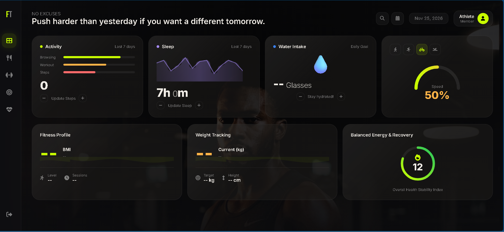

# FitTrack



FitTrack is a web-based fitness tracking application that helps users manage their workout journey in one place. It combines authentication, onboarding, personalized dashboard metrics, workout discovery, meal planning, weekly goal tracking, and body profile management using a simple PHP + MySQL backend with a vanilla HTML, CSS, and JavaScript frontend.

## Overview

FitTrack is designed for users who want a lightweight fitness companion to:

- Create an account and log in securely.
- Complete an onboarding flow with body stats, health details, preferences, and schedule.
- View a personalized dashboard with activity, sleep, water intake, BMI, and weight tracking.
- Explore workout videos and workout music recommendations.
- Generate AI-style meal plans based on budget, diet, and fitness goal.
- Track weekly tasks and habits.
- Review and update body/profile information.

## Features

- **User Authentication**: Signup and login with password hashing using PHP `password_hash` / `password_verify`.
- **Onboarding Flow**: Collects age, gender, height, weight, goals, diet, activity level, workout preferences, and schedule.
- **Personalized Dashboard**: Displays user stats, BMI, weight progress, sleep, steps, and water intake with quick update controls.
- **Workout Library**: Fetches workout videos from YouTube based on user profile and filters; includes a workout music player.
- **AI Meal Guide**: Generates meal suggestions based on budget range, dietary preference, and fitness goal; logs meals to the database.
- **Weekly Goals**: Manages weekly to-do tasks and habit streaks using browser local storage.
- **Body Stats Management**: View and edit saved profile details from a dedicated page.
- **Automatic DB Setup**: The database connection script creates the `fittrack` database and required `users` table/columns if they do not exist.

## Tech Stack

- **Frontend**: HTML5, CSS3, Vanilla JavaScript
- **Backend**: PHP (PDO)
- **Database**: MySQL / MariaDB
- **APIs / Libraries**:
  - YouTube Data API (workout video search)
  - YouTube IFrame API (music playback)
  - Font Awesome
  - Google Fonts

## Project Structure

```text
naya/
├── index.php                     # Entry point, redirects to login page
├── db.php                        # Root DB helper (includes login_page/db.php)
├── register.php                  # Redirects to login page
├── ss.png                        # Project screenshot used in README
├── auth/
│   ├── add_meal.php              # Save logged meals
│   └── get_meals.php             # Fetch logged meals
├── dashboard/
│   ├── dashboard.html            # Main dashboard UI
│   ├── dashboard.js              # Dashboard interactions and profile rendering
│   ├── dashboard.css             # Shared dashboard/app styling
│   ├── body_stats.html           # Profile/body stats page
│   ├── body_stats.js             # Profile load/edit logic
│   ├── meal_guide.html           # Meal planner UI
│   ├── meal_guide.js             # Meal generation/logging logic
│   ├── meal_guide.css            # Meal guide styles
│   └── update_user_stats.php     # Updates water/sleep/steps
├── login_page/
│   ├── login.html                # Login/signup UI
│   ├── script.js                 # Login/signup client logic
│   ├── style.css                 # Login page styling
│   ├── login.php                 # Login endpoint
│   ├── signup.php                # Signup endpoint
│   ├── db.php                    # PDO connection + DB/table bootstrap
│   └── get_user_goal.php         # Fetch user goal
├── stats/
│   ├── onboarding.html           # Onboarding UI
│   ├── onboarding.js             # Onboarding client logic
│   ├── onboarding.css            # Onboarding styles
│   └── onboard.php               # Save onboarding/profile data
├── weekly_goal/
│   ├── weekly_goal.html          # Weekly tasks/habits UI
│   ├── weekly_goal.js            # Task/habit localStorage logic
│   └── weekly_goal.css           # Weekly goals styles
└── workouts/
    ├── workouts.html             # Workouts UI
    ├── workouts.js               # Workout video/music logic
    ├── workouts.css              # Workout styles
    └── get_user_profile.php      # Fetch user profile for dashboard/workouts
```

## Getting Started

### Prerequisites

- **PHP** 8.x or newer (PHP 7.4+ should also work)
- **MySQL** or **MariaDB**
- A local web server stack such as **XAMPP**, **WAMP**, **Laragon**, or PHP's built-in server
- Internet connection for CDN assets (fonts/icons) and YouTube workout features

### Installation

1. **Clone or download the project**

   Place the project folder in your web server directory. For XAMPP, this is typically:

   ```text
   C:\xampp\htdocs\FitTrack\naya
   ```

2. **Start MySQL and PHP/Apache**

   - If using XAMPP: start **Apache** and **MySQL** from the XAMPP Control Panel.
   - If using PHP built-in server: ensure MySQL is running separately.

3. **Configure database credentials (if needed)**

   The default database configuration is in [`login_page/db.php`](login_page/db.php):

   ```php
   $host = '127.0.0.1';
   $db   = 'fittrack';
   $user = 'root';
   $pass = '';
   ```

   Update these values to match your local MySQL setup.

4. **Run the application**

   - **XAMPP/Apache**: open `http://localhost/FitTrack/naya/index.php`
   - **PHP built-in server**: from the project root, run:

     ```powershell
     php -S localhost:8000
     ```

     Then open `http://localhost:8000/index.php`.

> **Important:** Open the project through `http://localhost/...`, not by double-clicking HTML files (`file://`). PHP endpoints and `fetch()` requests require a running PHP server.

## Usage

### 1. Create an Account

- Open the app and use the **Create Account** form on the login page.
- Enter your name, email, password, and fitness goal.
- After signup, you are redirected to the onboarding flow.

### 2. Complete Onboarding

- Fill in body stats, health information, exercise preferences, and workout schedule.
- Save the onboarding details to personalize dashboard and workout recommendations.

### 3. Use the Dashboard

- View your daily stats: steps, sleep, water intake, BMI, weight progress, and profile summary.
- Use the quick +/- controls to update water, sleep, and steps.
- Navigate using the sidebar to Meals, Workouts, Weekly Goals, and Body Stats.

### 4. Generate Meals

- Open **Meal Guide**.
- Select budget, diet preference, and fitness goal.
- Click **Generate Plan** to get meal suggestions.
- Use **Log Meal** to save a meal entry to the database.

### 5. Explore Workouts

- Open **Workouts** to load personalized workout video recommendations.
- Filter by discipline (All, Yoga, Cardio, Strength).
- Play workout videos in the modal and use the built-in music player.

### 6. Track Weekly Goals

- Open **Weekly Goals**.
- Add daily tasks and weekly habits.
- Mark tasks complete and toggle habit days to track streaks.
- Tasks and habits are stored in browser local storage for the signed-in email.

### 7. Update Body Stats

- Open **Body Stats** to review your saved profile.
- Click **Edit Profile**, update fields, and save changes.

## Database Notes

- The app auto-creates the `fittrack` database and `users` table on first connection through [`login_page/db.php`](login_page/db.php).
- Meal endpoints create the `meals` table automatically when used.
- Default local credentials assume a standard XAMPP MySQL setup (`root` with no password). Change them for your environment.

## Security & Configuration Notes

- **YouTube API Key**: [`workouts/workouts.js`](workouts/workouts.js) contains a client-side YouTube Data API key for workout search. Replace it with your own key for production or shared deployments and restrict it appropriately.
- **Local Development Defaults**: Database credentials are configured for local development. Use secure credentials in production.
- **Authentication**: This project uses basic email-based flows and local storage for session convenience. For production use, add server-side sessions, CSRF protection, input validation hardening, and proper access control.

## Troubleshooting

- **Blank page or PHP code showing**: Ensure PHP is running and you opened the app through `http://localhost/...`.
- **Database connection error**: Verify MySQL is running and credentials in [`login_page/db.php`](login_page/db.php) are correct.
- **Workouts not loading**: Check internet access and the YouTube API key/quota in [`workouts/workouts.js`](workouts/workouts.js).
- **Profile/data not persisting**: Confirm MySQL is running and the app can write to the `fittrack` database.
- **Styles/scripts not updating**: Hard refresh the browser (`Ctrl+F5`).

## License

This project is provided for educational and personal use. Add a license file if you plan to distribute it publicly.